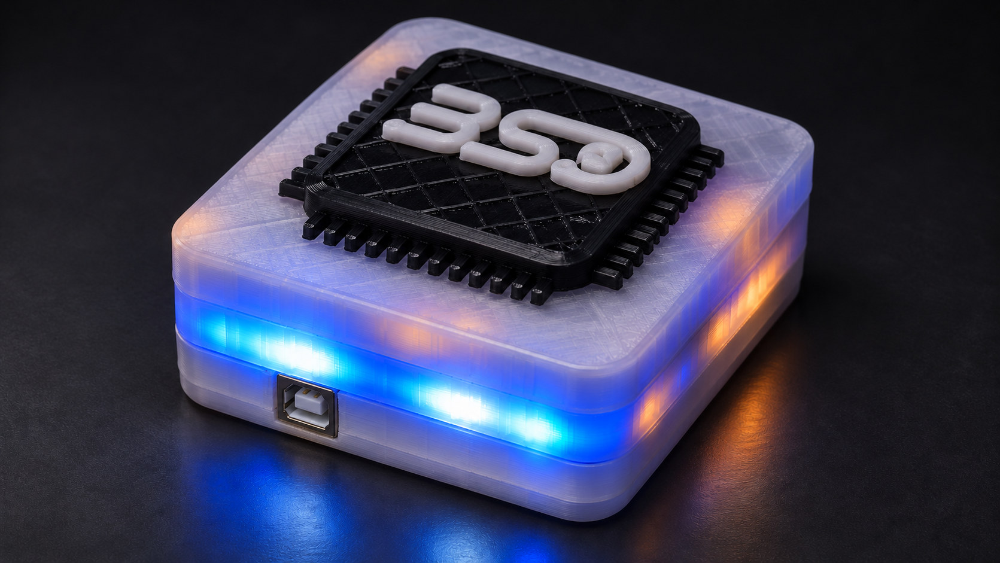
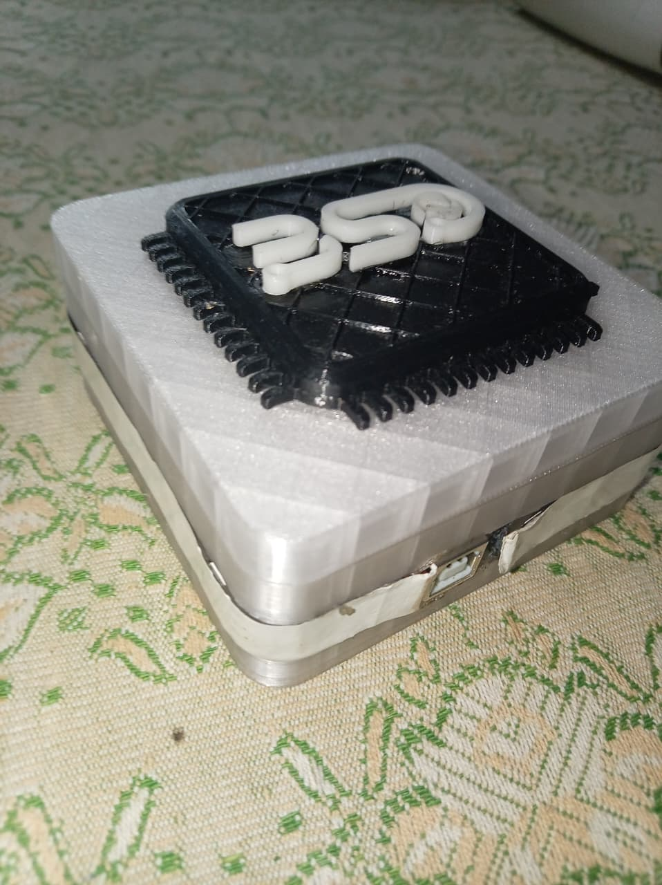
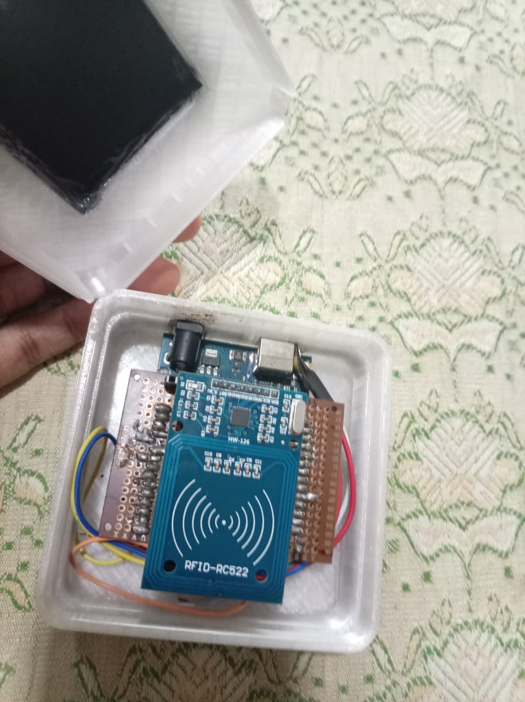
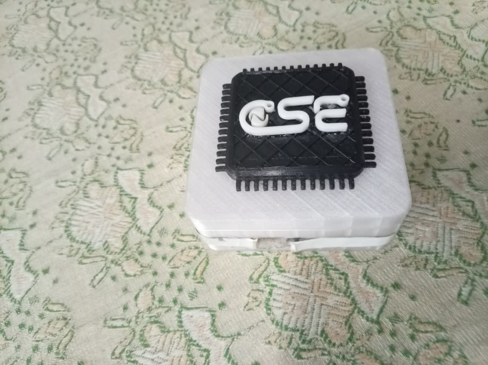

# CeremonyTap

**An RFID card-tap controller for flame-free ceremonial lighting.**

CeremonyTap is a physical device that gives each guest a simple way to take part in a digital oil-lamp ceremony: tap a card, see the enclosure respond with light, and activate the guest's assigned lamp in a connected web experience. The same `CARD:UID` output can be adapted to other software or lighting installations.



*Product visualization based on the built device. [See photographs of the real hardware](#physical-build).*

## Why it exists

Traditional oil lamps bring an open flame and smoke into indoor venues. A virtual lamp avoids those conditions, but a mouse click takes away the physical moment of participation. CeremonyTap restores that interaction with a card tap and an illuminated handheld controller.

## How it works

```text
Guest RFID card
      ↓
RC522 reader → Arduino Uno → 21 addressable LEDs in a translucent enclosure
                     ↓
             USB serial: CARD:<UID>
                     ↓
       Web Serial in the companion event website
                     ↓
           Assigned virtual lamp activates
```

The Arduino reads a card's UID and sends it as uppercase hexadecimal over USB serial at **9600 baud**. The companion [CSE AGM lamp ceremony website](https://github.com/Uvin-Kaveesh/CSE-AGM) uses the browser's Web Serial API to read that line, assign a card to a lamp, and trigger the mapped lamp. Guest-to-lamp mapping lives in the website; the Arduino firmware does not store guest identities.

At the same time, the controller plays a short light sequence through an **internally mounted WS2812B strip**. The enclosure's translucent perimeter diffuses the light rather than exposing individual LEDs.

## Physical build

| Exterior | Electronics | Side profile |
| :---: | :---: | :---: |
|  |  |  |

The photographed build uses an Arduino Uno, an RC522/MFRC522 RFID reader, a soldered prototyping board, addressable LEDs, and a translucent 3D-printed enclosure with a raised tap surface. A USB-B port is accessible on the front edge.

## Firmware at a glance

| Item | Implemented behavior |
| --- | --- |
| Reader | MFRC522 over SPI; chip-select pin **D10**, reset pin **D9** |
| LED output | **21 WS2812B** LEDs on **D6**, GRB order, FastLED brightness 80 |
| Serial protocol | `CARD:<UPPERCASE_HEX_UID>` followed by a newline, **9600 baud** |
| Repeat handling | The same UID is suppressed for **3 seconds**; a different UID can trigger immediately |
| Idle lighting | Breathing navy-blue base with three slowly moving amber glows |
| Tap lighting | 2.2-second sequence: electric charge → blue/white lightning → warm pulse → fade to idle |

The tap sequence is divided into four phases in the [Arduino sketch](firmware/CeremonyTap/CeremonyTap.ino):

| Elapsed time | LED effect |
| --- | --- |
| 0–250 ms | Electric-blue charging sparks |
| 250–700 ms | Blue and white lightning flashes |
| 700–1400 ms | Warm energy pulse moving from the center |
| 1400–2200 ms | Fade back toward ambient color |

## Run the controller

1. Install the **MFRC522** and **FastLED** libraries in the Arduino IDE.
2. Open [`firmware/CeremonyTap/CeremonyTap.ino`](firmware/CeremonyTap/CeremonyTap.ino) and select an **Arduino Uno**.
3. Connect the RC522 to the Uno's SPI interface, with SS on D10 and RST on D9. Connect the WS2812B data input to D6. Verify the reader's **3.3 V** power and logic compatibility, and check the LED power budget for your build before powering it.
4. Upload the sketch. A valid card tap should produce a line such as `CARD:FAD0D505` at **9600 baud** and start the LED sequence.
5. Open the [companion website](https://github.com/Uvin-Kaveesh/CSE-AGM) in a desktop browser with Web Serial support, connect the Arduino port, and use its ID learner to assign guest cards to virtual lamps.

The firmware-defined pins above are not a complete wiring diagram; the physical build photos show the prototype, but individual power and SPI connections should be verified before reproducing it.

## Repository contents

```text
firmware/CeremonyTap/CeremonyTap.ino  Arduino source supplied from the working build
media/photos/                       Photographs of the actual physical product
media/render/                       Illustrative product visualization
```

## Scope and status

- **Implemented here:** a wired Arduino Uno and RC522 controller, UID output over USB serial, and local addressable-LED feedback.
- **Companion application:** the [CSE AGM website](https://github.com/Uvin-Kaveesh/CSE-AGM), which handles Web Serial input, card-to-lamp assignment, and the virtual ceremony interface.
- **Future direction:** a smaller wireless version is being explored separately. It is not part of this firmware or photographed build.

The UID is used as an interaction identifier, not as secure authentication. The repository contains source and build photographs; it does not include measured reliability or venue-safety certification data.

